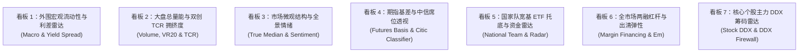

# A股全维度量化复盘与七大看板监控技能（A-Share Quant Review & Fusion Suite）

本项目是将 **A股全盘量化监控套件** 与 **工业级宽基ETF一级市场申赎与分时雷达** 深度融合的机构级量化系统。全套件坚持**强确定性数学规则驱动**，杜绝大模型自由心证与数据造假。

---

## 一、快速开始与环境安装（Quickstart）

### 1. 推荐依赖安装（钉版清单）
```bash
# 进入技能目录
cd ashare-quant-review

# 安装推荐依赖（推荐环境 Python 3.10 ~ 3.12）
pip install -r requirements.txt
```

### 2. 三层模块防护与优雅降级（Graceful Degradation）
本套件具备极高跨环境可移植性，无论在极简环境还是完整量化容器中均能稳定运转：

| 运行环境层级 | 包含依赖 | 系统行为与可用看板 | 降级容错机制 |
|:---|:---|:---|:---|
| **基础层（0 外部依赖）** | 仅 Python 标准库 (`urllib`, `json`, `datetime`, `math`, `statistics`, `sqlite3`) | 看板 1、看板 2、看板 3、看板 6、看板 7 完全自给自足 | 矩阵计算自动采用标准库替代；分钟快照采用内置 SQLite 存储 |
| **标准层（推荐）** | 标准库 + `pandas` + `requests` + `pyarrow` | 七大看板全部满血运行，分钟快照使用列式 Parquet 秒级存取 | 完整点亮 20/60 日同进度雷达 |
| **全功能层** | 标准层 + `akshare` | 解锁历史交易日中金所席位自动穿透回放 | `akshare` 缺失时，期指看板 4 席位行自动标注 `[已优雅降级]`，基差与判别器依然可用 |

---

## 二、一键调用与命令行接口（CLI Usage）

```bash
# 1. 运行全量套件并输出标准 Markdown 综合复盘报告（适合 AI Agent 阅读或保存）
python scripts/run_quant_suite.py --format markdown

# 2. 导出纯 JSON 结构化数据（适合上层应用二次解析）
python scripts/run_quant_suite.py --format json

# 3. 指定历史交易日回放与保存报告
python scripts/run_quant_suite.py --date 20261118 --format markdown --save ./reports/review_20261118.md
```

---

## 三、七大看板结构与指标口径规格



### 看板 1：外围宏观流动性与利差雷达 (`fetch_macro.py`)
- **监控指标**：10Y 美债收益率、10Y 中债收益率、中美 10Y 利差 (BP)、离岸人民币汇率 (USD/CNH)、美元指数 (DXY)、美联储 FOMC 议息倒计时与日程。
- **阈值基准**：
  - 利差倒挂深度 $<-250\text{ BP}$ 触发强防守警戒；收窄至 $>-150\text{ BP}$ 为流动性缓释。
  - USD/CNH 突破 7.30 警惕外资避险流出；跌破 7.15 确认为风险偏好修复窗口。
- **零伪造原则**：彻底根除 5.01/1.63/6.66/102.2 伪造默认值，接口异常显式返回 `None` 并告警。

### 看板 2：大盘总量能与双创 TCR 拥挤度 (`fetch_tech_volume.py`)
- **监控指标**：沪深北三市总成交额（含北交所）、全天 U 型经验分布预估成交额、量能环比边际增减额与幅度、创业板综/科创综指/科创芯片成交额、双创拥挤度 TCR、成交量比率 $VR_{20}$。
- **阈值规则**：
  - TCR $> 40.0\%$：**极端过热与流动性虹吸**（HIGH_ALERT）；
  - $33.0\% < \text{TCR} \le 40.0\%$：**结构分歧警戒区**（CAUTION）；
  - $25.0\% \le \text{TCR} \le 33.0\%$：**健康活跃与良性换手**（HEALTHY）；
  - $\text{TCR} < 20.0\%$：**情绪冰点与极度缩量**（FREEZING_OPPORTUNITY）。
  - $VR_{20} = \frac{\sum V_{up} + 0.5 \sum V_{flat}}{\sum V_{down} + 0.5 \sum V_{flat}} \times 100$：$<70$ 中线超卖低吸区；$>250$ 中线极度过热出货区。
- **日历守卫**：接入静态交易日历，法定假日盘中严格返回休市态，禁止 U 型外推。

### 看板 3：市场微观结构与全景情绪 (`fetch_market_sentiment.py`)
- **监控指标**：全市场 5500+ 个股真实上涨/下跌/平盘家数、涨跌比、全市场真实中位数涨跌幅、P25/P75 分位数与偏度、封死涨停、炸板率、连板梯队、剪刀差背离形态、综合情绪得分（0~100）与情绪档位。
- **真中位数原则**：彻底废弃前 100 采样，直连全市场行情快报计算真中位数，真实反映个股赚钱效应。

### 看板 4：期指基差与中信席位透视 (`fetch_cffex.py`)
- **监控指标**：IF/IC/IM/IH 主力基差、交割周平滑年化贴水率、中信期货（代客）四大合约多空净持仓、**中信席位行为判别器三件套**。
- **交割周保护**：剩余自然日 $\le 4$ 天时，当月年化标 `N/A (交割周保护)`，自动切换次月主力合约计算年化贴水率，防范分母趋近于 0 造成的数值发散爆炸。
- **中信席位行为判别器规则矩阵**：
  - **象限 A（现货涨 + 净空激增 $\ge 3500$）**：**【被动套保】**，机构总论：**【加法（净风险敞口在增）】**，置信度 HIGH。严禁定性为看空！
  - **象限 B（现货跌 + 净空激增 $\ge 3500$）**：**【主动做空动能】**，机构总论：**【减法（净风险敞口在减）】**，杀伤力极高。
  - **象限 C（现货涨 + 净空剧减 $\le -3500$）**：**【空头回补】**，机构总论：**【中性对冲（阶段修复）】**。
  - **象限 D（现货跌 + 净空剧减 $\le -3500$）**：**【被动减仓】**，机构总论：**【减法（被动撤退，杀伤力低于主动做空）】**。
  - **缩量过滤**：两市缩量 $\le -5.0\%$ 且净空未破阈值，置信度强制为 **LOW**，打标【低量无序震荡】。

### 看板 5：国家队宽基 ETF 托底与资金雷达 (`fetch_etf_flows.py` & `fetch_etf_radar.py`)
- **监控指标**：20 只核心宽基 ETF 日度净申赎（沪深对齐、亿元）、12 类宽基分类资金轮动分布、20/60 日同进度成交倍数与雷达状态（normal/warming/watch/strong）、5 分钟成交脉冲双确认（burst）。
- **沪深交易所清算对齐规则**：
  - 沪市 (.SH)：取 $T$ 日晚间份额 - $T-1$ 日晚间份额；
  - 深市 (.SZ)：取 $T+1$ 日晨间份额 - $T$ 日晨间份额；$T+1$ 晨未出前强置 `None`，严禁提前输出。
- **机械折算熔断安全网**：当 $(sr > 1.5 \text{ 或 } sr < 0.67) \text{ 且 } |sr \times nr - 1.0| < 0.08$ 时，强制将当日净申赎置为 `None`，杜绝基金拆细误报。
- **内置冷启动种子**：打包 `data/demo-seed.json`，全新部署首次运行即可点亮 20/60 日同进度雷达。

### 看板 6：全市场两融杠杆与出清弹性 (`fetch_leverage_margin.py`)
- **监控指标**：全市场融资融券余额与单日变动（法定 T+1 披露）、重点自选股融资余额跟踪、两融出清弹性系数 $E_m$。
- **出清弹性公式与定性**：
  - $E_m = \frac{\Delta \text{Margin}\%_{5d}}{\Delta \text{Index}\%_{5d}}$（滚动 5 日测算）。
  - 在指数下跌语境下：$E_m > 1.2$ 为**出清充分**（杠杆盘踩踏释放完毕）；$E_m < 0.5$ 为**出清不足**（杠杆盘拒不割肉，仍有补跌风险）。指数上涨时只报数值不贴标签。

### 看板 7：核心个股主力大单 DDX 筹码雷达 (`fetch_fund_flow.py`)
- **监控指标**：自选股现价与涨跌幅、主力净流入（超大单 $\ge 100$ 万 + 大单 $20\sim 100$ 万）、DDX 净控盘度（%）、5 大量价背离标签、近 3 日/5 日主力沉淀。
- **自选股配置池**：默认预置 5 只科技核心股（中微公司、北方华创、中芯国际、海光信息、寒武纪，位于 `data/default_watchlist.json`），用户提供 `references/custom_stocks.json` 时自动优先覆盖。
- **⚠️ DDX 防火墙（The DDX Firewall）**：严格限定于个股；代码层对宽基 ETF 标的调用 DDX 强制拦截并抛出 `DDXFirewallViolationError`。

---

## 四、AI Agent 协作与研判规范（Agent Guidelines）

1. **确定性与分工界限**：
   - 所有的指标计算、比率折算、阈值打标与四象限行为判定，全部由 Python 代码中的确定性函数完成。
   - LLM / Agent 的职责是**读取并结构化呈现**，严禁大模型根据主观臆断篡改指标标签或自由心证推翻判别器结论。
2. **缺失值与告警显式传递**：
   - 当遇到网络 502、交易所停牌或接口降级返回 `None` 时，必须如实向用户报备数据缺失，严禁编造合理常数填充。
3. **时滞与因果律守卫**：
   - 两融为 $T-1$ 时滞，深市 ETF 净申赎为 $T+1$ 晨间披露。分析时必须理清时序，严禁出现“拿今日盘中暴跌解释昨日融资加仓”的倒因为果错误。
